# Core library guide

How MAGNETISiM describes a magnetic core and a core material: the families, the 2D model each one uses,
the meaning of every dimension letter and the material parameters. The files themselves are in
[`lib/core`](../lib/core/).

## Contents

1. [Core index](#core-index)
2. [Why two kinds of core: XY and RZ](#why-two-kinds-of-core-xy-and-rz)
3. [Dimension letters](#dimension-letters)
4. [Air gap](#air-gap)
5. [XY cores](#xy-cores)
6. [RZ cores](#rz-cores)
7. [Air cores and IPT pads](#air-cores-and-ipt-pads)
8. [Materials](#materials)

## Core index

The 29 families of the library, the 2D model each one uses and the figures that define its dimensions.
"+ plate" means a piece closed by a flat plate (`I`) instead of a second identical piece.

<!-- core-index:start -->
| Family | Model | Figures |
|---|---|---|
| E, EPlanar | XY | [E](#xy-cores) · [Gap](#air-gap) |
| EI, EIPlanar | XY + plate | [E](#xy-cores) · [plate I](#xy-cores) · [Gap](#air-gap) |
| U | XY | [U](#xy-cores) · [Gap](#air-gap) |
| UI | XY + plate | [U](#xy-cores) · [plate I](#xy-cores) |
| EL | XY | [E](#xy-cores) · [EL](#xy-cores) |
| ELT | XY + plate | [EL](#xy-cores) · [plate I](#xy-cores) |
| ETD, EER, EQ, ERPlanar, EC | RZ | [half section](#rz-cores) · [top view](#rz-cores) |
| EQPLT, EIRPlanar, EIC | RZ + plate | [half section](#rz-cores) · [top view](#rz-cores) · [plate I](#xy-cores) |
| PQ, PM | RZ | [half section](#rz-cores) · [PQ](#rz-cores) |
| PQI | RZ + plate | [half section](#rz-cores) · [PQ](#rz-cores) · [plate I](#xy-cores) |
| RM | RZ | [half section](#rz-cores) · [RM](#rz-cores) |
| P, PT, PH | RZ | [half section](#rz-cores) · [pot core](#rz-cores) |
| DS, HS | RZ | [half section](#rz-cores) · [DS](#rz-cores) |
| AIRXY | XY | [air core](#air-cores-and-ipt-pads) |
| AIRRZ | RZ | [air core](#air-cores-and-ipt-pads) |
| IPTXY | XY + plate | [IPT pads](#air-cores-and-ipt-pads) |
| IPTRZ | RZ + plate | [IPT pads](#air-cores-and-ipt-pads) |
<!-- core-index:end -->

## Why two kinds of core: XY and RZ

FEMM solves 2D problems, so MAGNETISiM turns each 3D core into one of two 2D models. Cores with
rectangular legs are cut in a plane and the cut is **extruded** with depth `F` (XY). Cores with a round
centre post are cut in half and the half section is **revolved** around the axis (RZ). The family
decides which one: it is the first value of its `CoreType`.

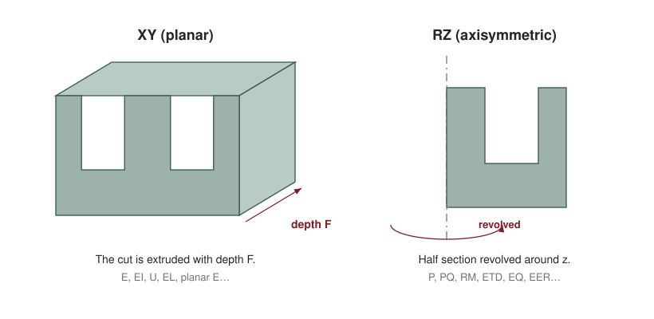

### RZ: the equivalent ring

Most RZ cores are not round outside: their outer legs are two blocks, not a ring. An axisymmetric model
can only revolve a ring, so MAGNETISiM replaces `A` with an equivalent width whose ring has the same
area as the real outer legs, and adjusts `D` (and `I` in a plate) in the same way, so that the flux sees
the real cross-sections. You always enter the real catalogue dimensions; the conversion happens inside
the application. The method is described in A. Vital, A. Delgado, "Core and Winding Modeling in
MAGNETISiM: a Platform For Fast Prototyping of Magnetic Components", 14th European Space Power
Conference (ESPC 2026), Estoril, Portugal.

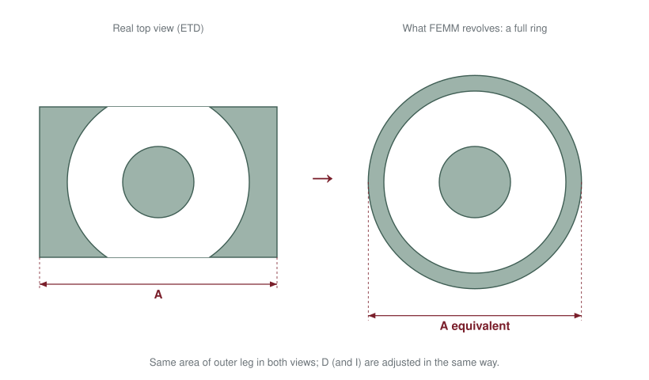

## Dimension letters

MAGNETISiM uses its own letters, **not the catalogue's**. All dimensions in mm.

| Letter | XY cores | RZ cores |
|---|---|---|
| `A` | Total width | Total width (or diameter) |
| `B` | Distance between the outer legs (window width) | Opening where the wires leave the core |
| `Bp` | — | Diameter of the round window (real winding width) |
| `C` | Width of the centre leg | Diameter of the centre post |
| `Cp` | — | Hole of the centre post |
| `D` | Height of **one half** | Height of **one half** |
| `E` | Window height of one half | Window height of one half |
| `F` | Depth (the FEMM depth of the 2D model) | Depth of the core |
| `G` | EL, ELT: depth of the base (then `F` is the centre-leg depth) | PQ, PQI, PM: bottom of the notch · RM: distance between the parallel cut faces |
| `I` | Height of the plate | Height of the plate |
| `Gap` | Air gap | Air gap |

Each reference also stores the catalogue `Ae` (mm²), `Ve` (mm³) and `Mass` (g).

## Air gap

The catalogue entries have `Gap` = 0 (an ungapped core); you set the gap in MAGNETISiM. It can be one
number (the same in every leg) or one per leg: `[left, centre, right]`.

- The two halves sit apart by the smallest of the three gaps.
- A leg with a larger gap is ground shorter: in a set the cut is shared by both halves; with a plate it
  is all in the E piece.
- RZ cores take two values: outer legs and centre post.
- IPT takes one value: the distance between the two pads.

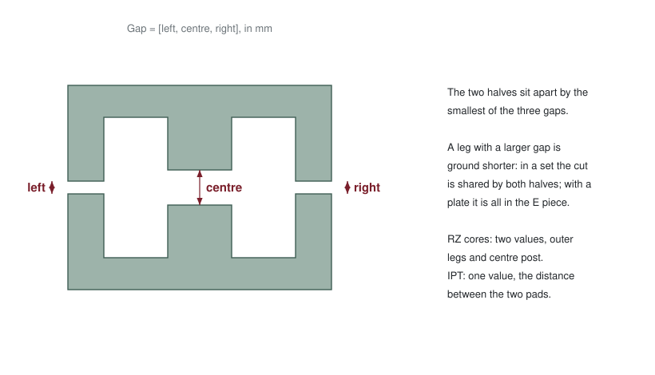

## XY cores

All dimensions are given on the drawing of the two halves. `D` and `E` always refer to **one half**.

**E, EPlanar**

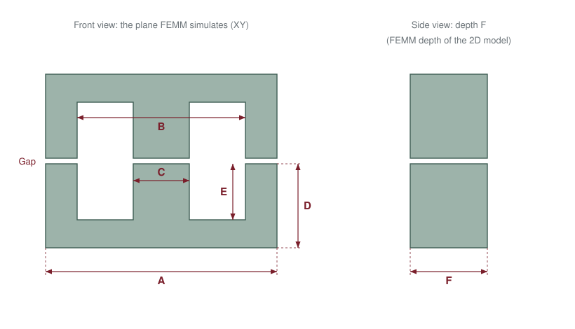

**Piece + plate (EI, EIPlanar, UI, ELT and the RZ families with a plate)**

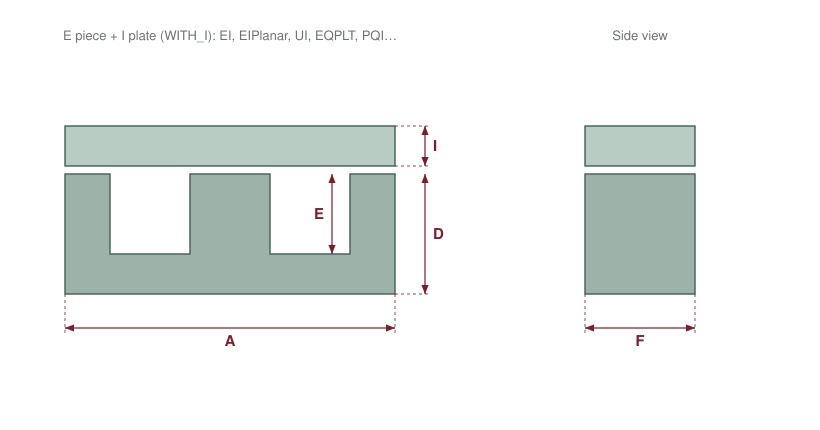

**U, UI**: two legs, `C` is not used.

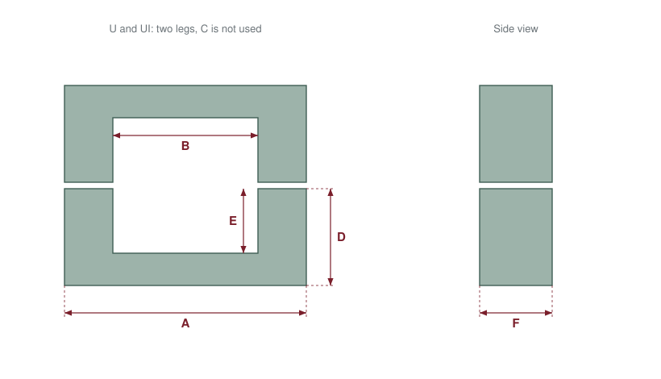

**EL, ELT**: the base is deeper than the centre leg, so `G` is the depth of the base and `F` the depth
of the centre leg. In the other XY cores `G` is not used.

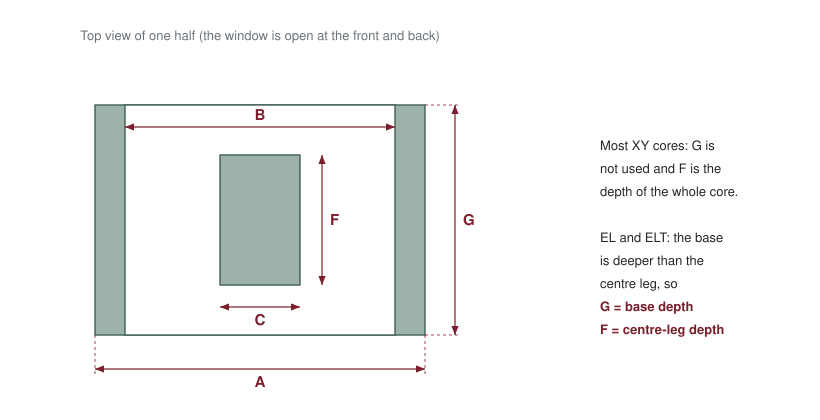

## RZ cores

The half section gives the radial dimensions; the top view gives the ones that make the core not round
(the opening `B`, the depth `F` and, in some families, `G`).

**Every RZ core**

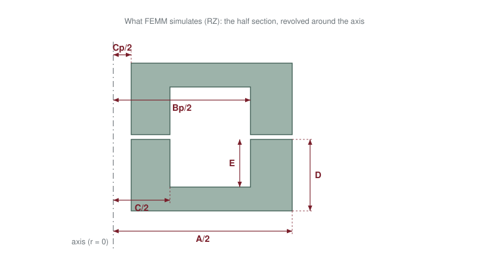

**ETD, EER, EQ, ERPlanar, EC** (and EQPLT, EIRPlanar, EIC with a plate)

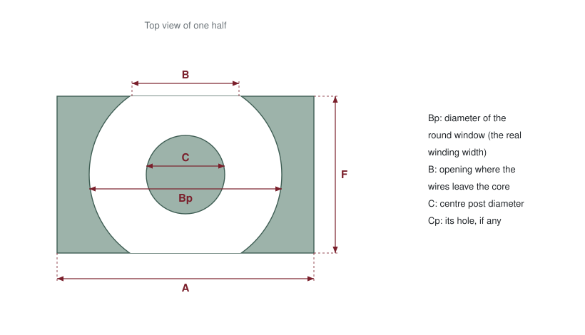

**PQ, PQI and PM**: `G` is the bottom of the notch.

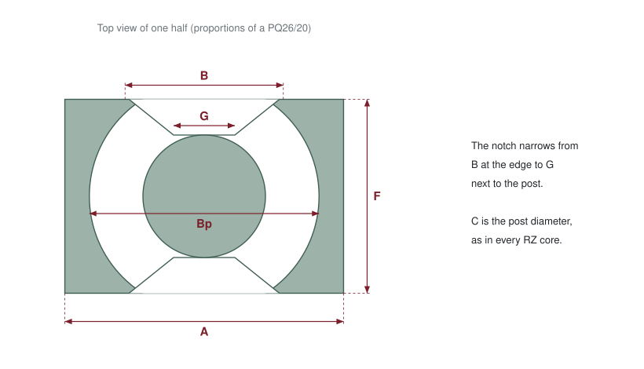

**RM**: `G` is the distance between the two parallel cut faces.

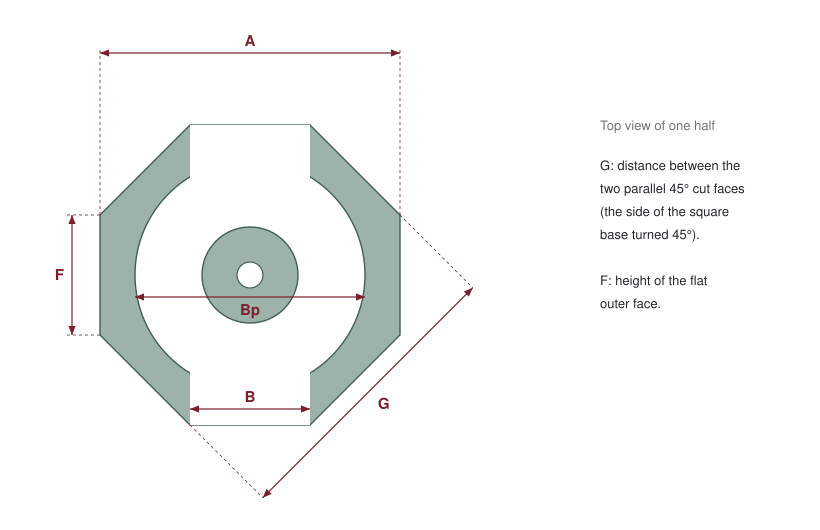

**P, PT and PH**: two slots of width `B`.

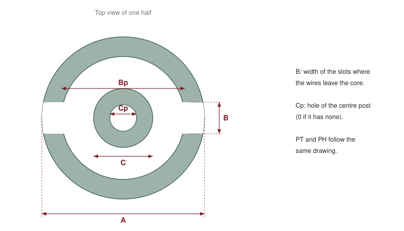

**DS and HS**: two flats; `F` is the distance between them.

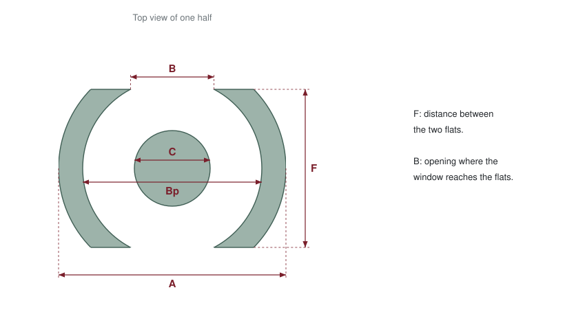

## Air cores and IPT pads

Two special families defined by the MAGNETISiM team: coils without a core, and the ferrite pads of
inductive power transfer.

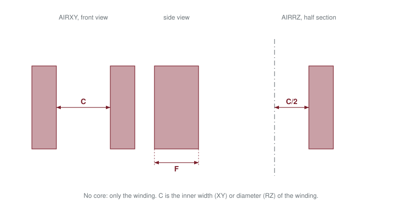

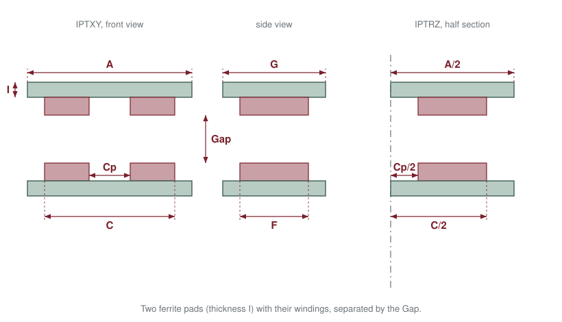

## Materials

Each entry of `material.py` describes one ferrite or powder material.

| Key | Meaning | Unit |
|---|---|---|
| `muR` | Relative permeability µ′, used when the frequency curve is off | — |
| `muI` | Imaginary part µ″, used when the frequency curve is off | — |
| `Cond` | Electrical conductivity of the core | S/m |
| `DebyeParameter` | Fit of µ′(f) (`Real`: y0, A, k, xc) and µ″(f) (`Imag`: a1, b1, c1, a2, b2, c2), with x = log10(f / 1 MHz) | — |
| `Phi` | Hysteresis lag angle of µ. 0 in the library: the complex permeability is not described, because datasheets do not always give it | degrees |
| `Bmax` | Saturation flux density from the catalogue (not used yet) | T |
| `Steinmetz` | `k`, `alpha`, `beta` of Pv = k·f^α·B^β | Pv in kW/m³, f in kHz, B (peak) in mT |
| `epsR`, `tanDelta` | Relative permittivity and dielectric loss tangent of the core (CAPACITISiM) | — |

### Permeability against frequency

When the frequency curve is on, MAGNETISiM evaluates µ′ and µ″ at each simulated frequency and gives FEMM
the magnitude |µ| and the lag angle. µ′ is a sigmoid in log-frequency and µ″ the sum of two Gaussians.
The fit is empirical: despite the key name, it is not a Debye relaxation model.

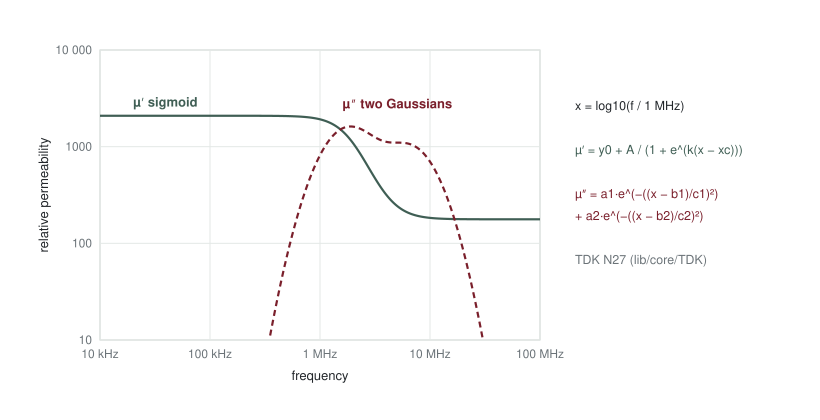

### Core losses

Core losses always use the Steinmetz equation with the peak flux density.

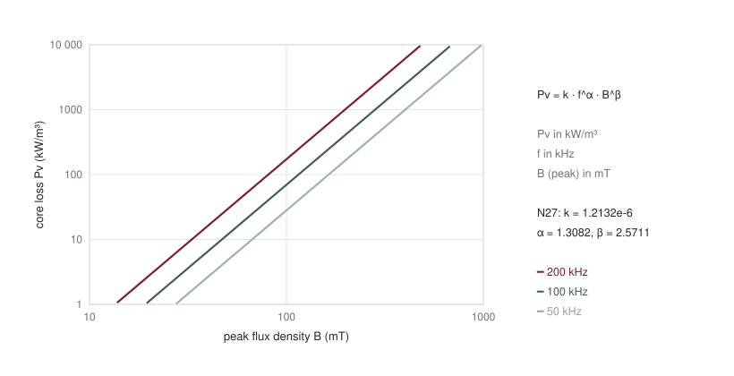

### How to add a material

1. Fill the Excel templates with the datasheet curves: [`Template/Materials/PowerLoss/`](../Template/Materials/PowerLoss/)
   (one Pv–B file per frequency) and [`Template/Materials/PermeabilityFrequency/`](../Template/Materials/PermeabilityFrequency/)
   (µ′ and µ″ against frequency). MAGNETISiM reads them in that format.
2. In MAGNETISiM, core material panel: **Add Permeability(f) Curve** loads the µ curve and fits it; the
   Power Loss tab loads the Pv–B files and fits k, α and β.
3. **File → Save Core Material Configuration** writes a `CoreMat.json`.
4. Add the values to an entry of `material.py`, or send them with the **Core or material data** issue
   form.
